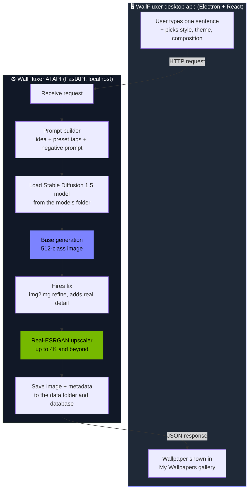

<h1 align="center">WallFluxer AI API</h1>

<p align="center">
  <b>The local image engine behind WallFluxer.</b><br/>
  A Python FastAPI service that turns one sentence into a 4K wallpaper, fully on your own GPU.
</p>

<p align="center">
  
  
  
  
  <a href="https://www.linkedin.com/in/sidharthan-jayavelu/"></a>
</p>

> This is the backend of **WallFluxer**, an Electron + React desktop app. The desktop app starts this service in the background, talks to it over localhost, and shuts it down when you close the window.

---

## 🔄 Workflow



**In short:** idea → prompt → base image → hires fix → AI upscale → saved wallpaper.

---

## 🧩 Tech

- **Python** and **FastAPI** for the local API
- **Stable Diffusion 1.5** (`.safetensors` models, bring your own or use the bundled one)
- **Real-ESRGAN** for upscaling
- **PyInstaller** to package everything into a single backend executable

---

## 📦 Models and data

Model files are **not** stored in this repo because they are several GB. The desktop app ships with a base model, and users can add their own.

```
models/    Stable Diffusion models and the upscaler (not in git)
data/      generated wallpapers and the local database (created on first run)
```

---

## ⚠️ Content warning

This service only runs models. I did not train or own any of them. Models can produce NSFW or mature content depending on the prompt and the model, and what you generate is your responsibility. Each model keeps its own license.

---

## 🙏 Credits

- **[DreamShaper 8](https://civitai.com/models/4384/dreamshaper)** by Lykon
- **[Real-ESRGAN](https://github.com/xinntao/Real-ESRGAN)**
- **[Stable Diffusion](https://github.com/CompVis/stable-diffusion)** by CompVis, Stability AI and Runway

---

## 📬 Contact

Built by **Sidharthan Jayavelu**. Reach me on [LinkedIn](https://www.linkedin.com/in/sidharthan-jayavelu/).