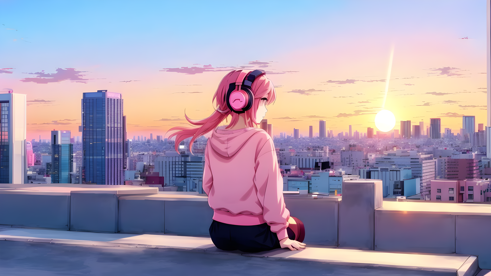
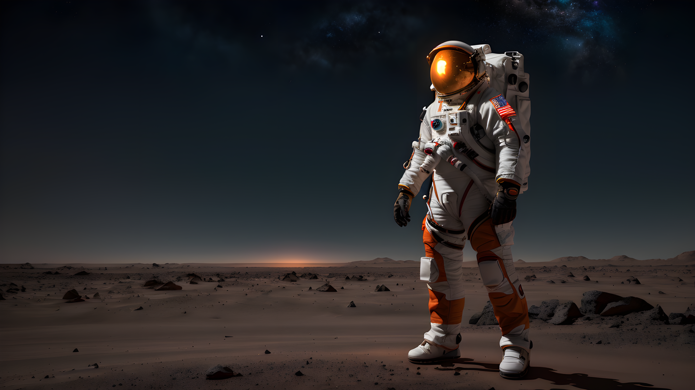
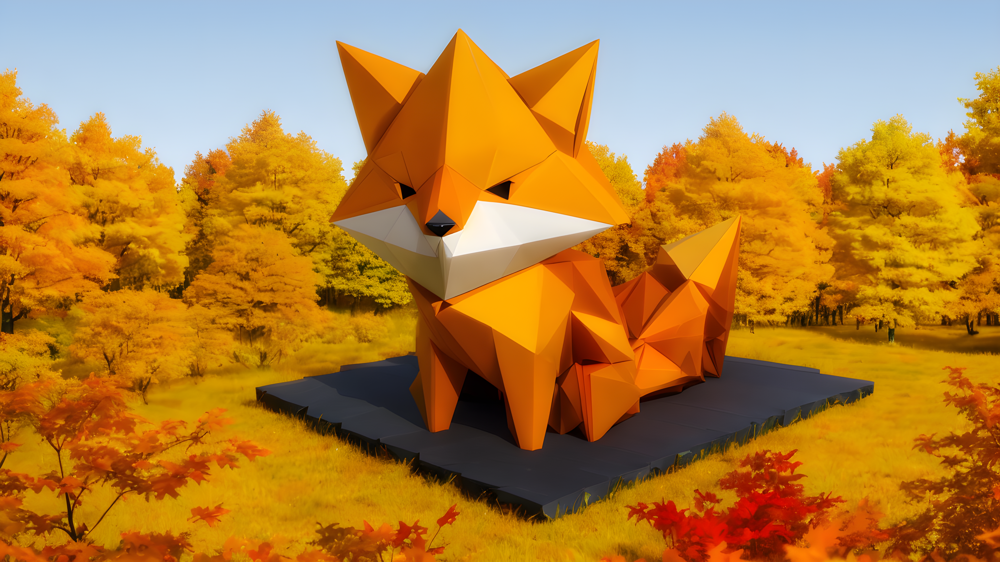
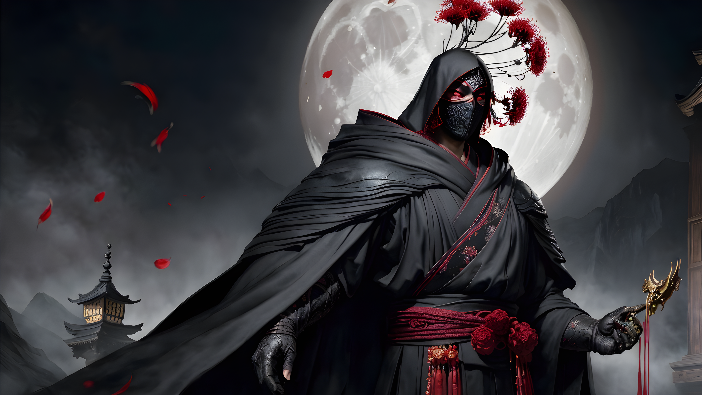
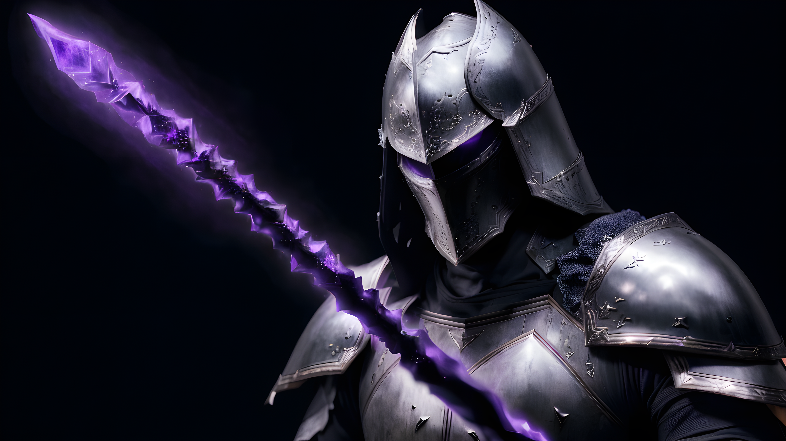
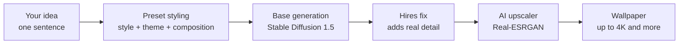

<p align="center">
  
</p>

<h1 align="center">WallFluxer</h1>

<p align="center">
  <b>One sentence. One click. A wallpaper worth keeping.</b><br/>
  A Windows desktop app that turns a simple idea into stunning 4K wallpapers, running fully on your own GPU.
</p>

<p align="center">
  
  
  
  
  
  
</p>

<p align="center">
  <b>Designed and built by <a href="https://www.linkedin.com/in/sidharthan-jayavelu/">Sidharthan Jayavelu</a></b><br/>
  <a href="https://www.linkedin.com/in/sidharthan-jayavelu/"></a>
</p>

<p align="center">
  <a href="https://drive.google.com/file/d/1u_zpunrsRhmcsf3D8uUy82hOUTY83nnR/view?usp=sharing"><b>⬇ Download for Windows</b></a>
</p>

---

## ✨ What is WallFluxer?

Type one sentence, pick a look from ready-made presets, and hit generate. WallFluxer builds the optimized prompt for you, runs a multi-stage image pipeline on your own graphics card, and hands back a sharp wallpaper at up to **4K and beyond**.

No subscriptions. No cloud. No queue. Your ideas never leave your PC.

---

## 🚀 Get started in 3 steps

No installer and no setup. Download, extract, double-click.

1. **[Download the zip from Google Drive](https://drive.google.com/file/d/1u_zpunrsRhmcsf3D8uUy82hOUTY83nnR/view?usp=sharing)** (about 5 GB).
   The 5 GB already includes the base model and everything the app needs. There is nothing else to install, so you can download with confidence.
   Google may warn that the file is too large to scan for viruses. Click **Download anyway**.
2. **Extract the whole zip** to a folder you own, for example:
   ```
   D:\WallFluxer-v0.0.0-win-x64\
   ```
3. **Launch the app** by double-clicking:
   ```
   D:\WallFluxer-v0.0.0-win-x64\WallFluxer\WallFluxer.exe
   ```

WallFluxer starts its own engine in the background, shows a loading screen while it warms up, then opens the app. When you close the window, the engine shuts down with it.

> **Windows SmartScreen:** because the app is not code-signed, Windows may show *"Windows protected your PC"* the first time. Click **More info**, then **Run anyway**.

> **Important:** extract *everything* first. Don't run the exe from inside the zip, and keep the `backend` and `models` folders next to `WallFluxer.exe`.

### 🖥️ Requirements

| | |
|---|---|
| **OS** | Windows 10 or 11 (64-bit) |
| **GPU** | NVIDIA, **3 GB VRAM or more** |
| **Disk** | About 6 GB or more free |
| **Internet** | Only needed to download the app. Generation runs fully offline. |

---

## 🖼️ Examples

<table>
  <tr>
    <td></td>
    <td></td>
  </tr>
  <tr>
    <td></td>
    <td></td>
  </tr>
  <tr>
    <td></td>
    <td></td>
  </tr>
  <tr>
    <td></td>
    <td></td>
  </tr>
</table>

---

## 🎨 Make your first wallpaper

1. Open **Create**.
2. Type your idea, for example *"a quiet mountain lake at dawn"*.
3. Pick a **Style**, **Theme** and **Composition**, or skip them for a clean result.
4. Choose a resolution and hit **Generate**.
5. Find your finished wallpaper in **My Wallpapers**.

### Make it yours

- **My Models:** add your own Stable Diffusion models (`.safetensors`) and switch between them.
- **Prompt Presets:** create your own style, theme and composition presets and reuse them.
- **My Wallpapers:** browse everything you have generated.
- **Settings:** tweak the app to your liking.

---

## ⚠️ Content warning and responsibility

WallFluxer is only a **front-end wrapper** around Stable Diffusion models. I did not train, create or own any of the models used by this app.

- The bundled model and any model you add yourself **can produce NSFW or otherwise mature content**, depending on the prompt and the model.
- The app does **not** guarantee filtered or safe output.
- **What you generate and how you use it is entirely your responsibility.** That includes following the laws where you live and the license of each model you use.
- Do not use this software to create illegal content, or content that depicts real people without their consent.
- This app is intended for adults. Keep it away from children.

Each model keeps its own license and terms. The author of this app is not responsible for any content generated with it.

---

## 🧠 How it works

Stable Diffusion 1.5 is trained on 512×512 images, so asking it for a huge image directly gives poor results. WallFluxer uses a custom multi-stage pipeline instead:



1. **Your idea becomes a prompt.** Your sentence is combined with the preset tags you picked.
2. **Base generation.** A Stable Diffusion 1.5 model creates the image at the size it handles best.
3. **Hires fix.** The base image is refined so extra detail is generated, not just stretched.
4. **AI upscaling.** An upscaler scales the result up to wallpaper resolution while keeping it sharp.

---

## 🌟 Highlights

- **One-sentence wallpapers.** Describe your idea in plain words. WallFluxer handles the prompt engineering.
- **Pick-and-go presets.** Choose a Style, a Theme and a Composition with a click.
- **Up to 4K and more.** A custom pipeline scales a small base image into a crisp wallpaper.
- **Runs on your GPU.** Any Windows PC with an NVIDIA card of 3 GB VRAM or more can do it.
- **Bring your own models and presets.**
- **Your own gallery.** Browse and manage everything you have generated.
- **Ready out of the box.** Ships with a base model, so you can generate minutes after downloading.

---

## 🗂️ What's in the download

```
WallFluxer/
├── WallFluxer.exe     the app
├── backend/           the local image engine (starts and stops automatically)
├── models/            the base model and the upscaler
└── data/              created on first launch: your database and generated wallpapers
```

Everything you create stays in the `data` folder next to the app.

---

## 🧩 Built with

- **Desktop app:** [Electron](https://www.electronjs.org/), [React](https://react.dev/), [Vite](https://vitejs.dev/), [Material UI](https://mui.com/) and TypeScript
- **Engine:** Python and [FastAPI](https://fastapi.tiangolo.com/), packaged with PyInstaller
- **Image generation:** Stable Diffusion 1.5 with a custom hires-fix and upscaling pipeline

### What I built

WallFluxer is a complete product that I designed and built myself, from the interface down to the installer:

- **Desktop client:** an Electron + React + TypeScript app with a Material UI interface, gallery, model manager and preset editor.
- **Python backend:** a local FastAPI image engine that runs the full generation pipeline on the user's GPU. It lives in its own repository: 👉 **[WallFluxerAI-API](https://github.com/sidharth2000/WallFluxerAI-API)**
- **Custom image pipeline:** prompt building from presets, Stable Diffusion 1.5 generation, hires fix and Real-ESRGAN upscaling for 4K output.
- **Packaging and distribution:** the backend is packaged with PyInstaller and the app starts and stops its own engine, so users get a zero-setup download.

---

## 🙏 Credits

- **[DreamShaper 8](https://civitai.com/models/4384/dreamshaper)**, the Stable Diffusion 1.5 model that ships with the app. Credit to its creator, Lykon.
- **[Real-ESRGAN](https://github.com/xinntao/Real-ESRGAN)**, the upscaler used for the final resolution boost.
- **[Stable Diffusion](https://github.com/CompVis/stable-diffusion)** by CompVis, Stability AI and Runway.

Each model keeps its own license. Please check the original pages before redistributing them.

---

## 📬 Contact

Hi, I'm **Sidharthan Jayavelu**, the developer behind WallFluxer. Questions, feedback, ideas or opportunities to work together are all welcome.

👉 **[Connect with me on LinkedIn](https://www.linkedin.com/in/sidharthan-jayavelu/)**

If you like the project, a ⭐ on the repo helps a lot.

---

<p align="center">
  Made with ❤️ for people who think their desktop deserves better.
</p>